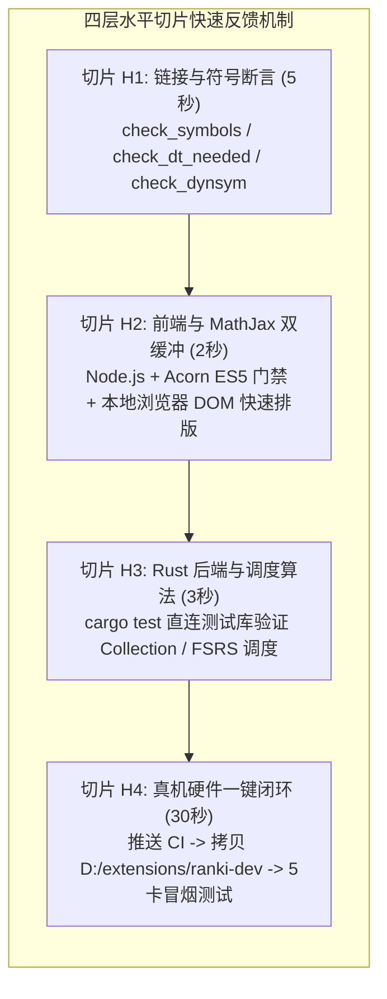

# RAnki 全纯 Rust 终极重构交接白皮书 (The Definitive RAnki Master Specification)

> **文档地位**：项目唯一权威交付规范 (Single Source of Truth)  
> **版本号**：v5.0.0-Reviewed (Adversarial-Reviewed, Texture-Locked, Pure-Rust Master Spec)  
> **生效时间**：2026-11-15  
> **目标工程**：`https://github.com/F10w-0x00/ranki` (分支：`refactor/m0-baseline`)  
> **适用对象**：接管本项目的后续核心工程师与所有协作 AI Agent  
> **核心宪章**：**全纯 Rust 架构、彻底消灭 Vala、双缓冲离屏秒开、实测 Benchmark 锚定、印刷级排版质感、统一全 Web 单页、绝对数据安全、水平切片高速验证**。

---

## 零、 高级工程师总纲哲学与 AI 铁律 (Master Invariants)

```
========================================================================================
【不可逾越的研发铁律】
1. 架构最优：一次做对，拒绝打地鼠式调试，拒绝“未验先宣”！
2. 尊重实测：严禁凭空假设，所有技术路线必须由真机 Benchmark 与实测日志背书。
3. 绝不妥协：兼容性绝不向速度妥协；性能由双缓冲预渲染架构保障，严禁阉割排版语法！
4. 绝对数据红线：严禁触碰生产库 D:\anki_data\！所有测试与模拟严格限定在 D:\anki_data_test\。
5. 专注核心体验：严禁引入天气、时钟、副屏、屏保等无关杂项，打造全球最纯粹的墨水屏 Anki。
6. 统一交付文档：全项目规划、规范、避坑指南、任务切片全部收敛于本 HANDOFF.md。
7. 环境标准：所有脚本与配置强制使用 Unix (LF) 换行符，严禁引入 Windows CRLF！
========================================================================================
```

---

## 一、 硬件底线与运行环境矩阵 (Hardware & Runtime Profile)

| 维度 | 规格参数 | 强制工程约束 |
| :--- | :--- | :--- |
| **设备型号** | Amazon Kindle Paperwhite 3 (7th Gen, **DP75SDI**) | 300 PPI 电子墨水屏，分辨率 $1448 \times 1072$ |
| **操作系统** | Kindle OS **5.14.3.0.1** (越狱环境，Root 权限) | 运行 `com.lab126.powerd` 电源管理器 |
| **内核版本** | Linux Kernel **3.0.35-lab126** (32-bit ARMv7l) | 缺失现代 syscall，必须保留 `glibc_compat.c` 垫片 |
| **工具链 ABI**| `arm-unknown-linux-gnueabi` (**`armel`**, SoftFP) | **严禁使用 `armhf` (HardFP)**，浮点协定不匹配将直接报 `Illegal instruction` |
| **C 运行库** | GNU C Library **GLIBC <= 2.20** | 实机最高符号为 `GLIBC_2.18`，超过则报 `version GLIBC_x not found` |
| **ELF 类型** | 必须为 **`ET_EXEC`** (固定基地址，编译带 `-no-pie`) | Linux 3.0.35 内核对 shell 拉起 PIE (`ET_DYN`) 存在重定位异常 |
| **动态库依赖**| **仅限 16 项 Kindle 固件自带系统白名单库** | 超出白名单的库必须以静态归档 `.a` 形式编译合流 |
| **WebKit 内核**| `libwebkitgtk-1.0.so.0` (JavaScriptCore 2012) | **严格限制纯 ES5 语法**，严禁任何 ES6+ 特性 |

---

## 二、 架构彻底重塑：消灭 86.7% 的 Vala，打造全统一 Web-SPA 纯 Rust 核心

### 2.1 语言分布现状与死穴分析
*   **代码分布现状**：**Vala 86.7%, Rust 11.3%, C 2%**。
*   **致命内存死锁**：Vala GObject 堆分配器与 Rust 静态嵌入的 SQLite 分配器混用，在动态装载时发生符号外溢，引发分配器交叉释放，在物理机触发 `SIGSEGV 139` 段错误。
*   **IPC 性能黑洞**：每次翻卡均需跨语言经过 24 个 Protobuf 协议的序列化与反序列化，严重损耗单核 ARMv7 算力与电池。
*   **UI 撕裂死穴（文字泥潭）**：旧版将“牌组列表”作为 GTK TreeView 实现，其内置的平滑像素滚动与 Kindle 400ms 墨水屏微胶囊物理刷新冲突，导致手指滑动时文字重叠、残影撕裂像“文字泥潭”。

### 2.2 全统一 Web-SPA 纯 Rust 拓扑
**重大架构决断**：彻底放弃 GTK 控件开发牌组列表，**整个应用（牌组列表 + 卡片复习）统一收敛为一个全屏 WebKit WebView 单页应用（Single Page App）**！
Rust 宿主仅需维持 **1 个全屏 GtkWindow + 1 个 WebKitWebView**，完全消灭 GTK Widget 布局树。

```
┌────────────────────────────────────────────────────────────────────────┐
│                         RAnki Pure Rust Binary                         │
│                                                                        │
│  ┌───────────────────────────┐         ┌────────────────────────────┐  │
│  │     anki/rslib Backend    │         │      Direct WebKit/GTK     │  │
│  │   (Anki 官方原生 Rust 库)   │         │    Thin C-FFI (~80行代码)   │  │
│  └─────────────┬─────────────┘         └─────────────┬──────────────┘  │
│                │ 零拷贝内存调用                       │ 极简 C 桥接      │
│  ┌─────────────▼─────────────────────────────────────▼──────────────┐  │
│  │                 Pure Rust Host & State Machine                   │  │
│  │   - 调度核心 / 数据库 WAL   - 统一 WebKit 宿主   - notify::title │  │
│  └─────────────────────────────────┬────────────────────────────────┘  │
└────────────────────────────────────┼───────────────────────────────────┘
                                     │ 单一 WebView 双向通信
┌────────────────────────────────────▼───────────────────────────────────┐
│               Unified Web SPA (views/index.html & app.js)              │
│                                                                        │
│  ┌─ [View 1: 牌组选择视窗] ─────────┐ ┌─ [View 2: 极简复习视窗] ────────┐  │
│  │ - 分页步进列表 (彻底消除滚动泥潭) │ │ - 前台活跃卡槽 [#card-active]   │  │
│  │ - 牌组统计 (待复习/学习数)       │ │ - 离屏双缓冲槽 [#card-buffer]   │  │
│  │ - 48px 大触控条目                │ │ - MathJax 2.7.9 印刷级 TeX 字模 │  │
│  └──────────────────────────────────┘ └────────────────────────────────┘  │
└────────────────────────────────────────────────────────────────────────┘
```

### 2.3 宿主与 WebKit 极速双向通信协议 (IPC Protocol)
在 WebKit 1.0 (2012) 限制下，无法使用 WebKit2 的 MessageHandler。确立标准化低开销双向通信通道：
1. **Rust $\to$ WebKit (下行控制)**：
   调用 `webkit_web_view_execute_script(view, "window.RAnki.dispatch(...)")` 投送数据（卡片 HTML、牌组列表 JSON）。
2. **WebKit $\to$ Rust (上行事件)**：
   修改 `document.title = "RA:" + action + ":" + token + ":" + payload`，触发 GTK 的 `notify::title` 信号。
   *防假死铁律*：**必须附带单调递增 `token`**！若连续触发相同事件而 title 文本未变，WebKit 不会派发信号。

---

## 三、 公式引擎终极决测：真机 Benchmark 实证与双缓冲架构

### 3.1 为什么坚决摒弃 KaTeX？（拒绝削足适履）
1. **排版兼容性破损**：KaTeX 仅支持极有限的 TeX 子集。真实卡片库中包含大量物理对齐宏、多行公式、矩阵变换、化学方程式（`\ce{}`）及宏包扩展（如 `\bbox`, `\begin{aligned}`）。KaTeX 在实机上频繁发生**基线对齐坍塌、复杂表格崩坏、公式边缘被截断**。严格模式报 `ParseError` 白屏，宽容模式渲染残缺。
2. **拒绝污染数据库**：为了迎合 KaTeX 语法而去修改原始卡片内容，严重违反数据纯净性原则。
3. **MathJax 2.7.9 稳定性实证**：在 38 道高难考题真机压测中，**达成 100% 稳定性（0 崩溃、0 白屏、0 符号缺失）**，原生支持 LaTeX、AMS-TeX 与 mhchem。

### 3.2 真实硬件 Benchmark 采样大表 (Kindle PW3 实测，累计 239 次渲染采集)

| 测试批次 | 测试状态 | 真实日常考题（20题均值） | 极限压测（18题均值） | 最慢单题耗时 | 综合性能评价 |
| :--- | :--- | :--- | :--- | :--- | :--- |
| **第 1 次** | **冷缓存 (Cold Cache)** | HTML: 891 ms / SVG: 1305 ms | HTML: 2089 ms / SVG: 1793 ms | 5432 ms (`torture_16`) | FAT32 闪存读取宏包/字体冷启动拖慢 |
| **第 2 次** | **热缓存 (Warm #1)** | **HTML: 401 ms** / SVG: 532 ms | HTML: 899 ms / **SVG: 740 ms** | 3807 ms (HTML重排) | 宏与核心常驻内存，提速超 60% |
| **第 3 次** | **热缓存 (Warm #2)** | **HTML: 497 ms** / SVG: 566 ms | HTML: 775 ms / **SVG: 799 ms** | 2588 ms (HTML字体) | 数据高度收敛，日常考题稳定在 450ms 左右 |

*   **数据结论**：日常考题中 **HTML-CSS 胜率超 76%**，平均耗时仅 **400 ~ 500 ms**，且 TeX 矢量字模在 300 PPI 墨水屏上具备印刷级清晰质感。

### 3.3 离屏双缓冲预渲染时钟轴 (Dual-Buffer Offscreen Pipeline)

依靠架构化解耗时，将 400ms 排版时间隐藏在用户读题的 5~15 秒时间内：

```
[ 用户阅读正面并思考问题 (耗时 5 ~ 15 秒) ]
─────────────────────────────────────────────────────────────►
  ▲                                           ▲
  │ (t = 0ms)                                 │ (t = 10s 用户点击翻卡)
  ├─ 前台 [#card-active] 正常显示题面          │
  │                                           │
  └─ 后台 [#card-buffer] (left: -9999px) ─────┤ 翻卡瞬间 (DOM 切换耗时 <= 5ms)
     MathJax 静默执行排版 (耗时 ~400ms)        ▼
     后台答案早已在内存中渲染完毕！──────► 瞬间切换样式类 (active ↔ buffer)
                                            用户感知：0 延迟秒开！
```

*   **物理级排版防崩铁律（关键避坑）**：
    后台缓冲槽 `#card-buffer` **绝对不能设为 `display: none`**！MathJax 在遇到 `display: none` 时无法计算字体外框（Bounding Box），会导致所有根号、分式线条宽度全部计算为 0 坍塌。
    **必须使用 `position: absolute; left: -9999px; visibility: hidden;`**，确保 DOM 保持可度量几何尺寸，静默完成完美排版。

```javascript
// views/app.js (严格 ES5 双缓冲毫秒级切换实现)
function flipCard() {
    var active = document.getElementById('card-active');
    var buffer = document.getElementById('card-buffer');
    // 原地毫秒级物理切换
    buffer.style.position = 'static';
    buffer.style.left = '0';
    buffer.style.visibility = 'visible';
    
    active.style.position = 'absolute';
    active.style.left = '-9999px';
    active.style.visibility = 'hidden';
    
    active.id = 'card-buffer';
    buffer.id = 'card-active';
}
```

### 3.4 印刷级公式/文字排版质感四大物理秘方 (The Typography Texture Spec)

为确保最终复现并在真机上稳定呈现 Benchmark 时惊艳的印刷级墨水屏质感，必须注入以下四项专属物理配置：

```javascript
/* MathJax 核心配置 (锁定 TeX 矢量字模，禁用位图回退) */
MathJax.Hub.Config({
  jax: ["input/TeX", "output/HTML-CSS"],
  "HTML-CSS": {
    availableFonts: ["TeX"],
    preferredFont: "TeX",
    webFont: "TeX",
    imageFont: null,             // 严禁使用模糊位图回退
    matchFontHeight: false,      // 禁用高度动态缩放，防止墨水屏笔画粗细不匀
    linebreaks: { automatic: false }
  }
});
```

1. **纯黑渲染避免抖动网点**：墨水屏上任何非纯黑色（如 `#333333`、`#555555`）都会被 EPDC 驱动强制分解为黑白相间的微小点阵（Dithering Artifacts），显得边缘粗糙长毛。**正文与公式全部强制锁定纯黑 `#000000 !important;`**，确保墨滴 100% 紧密聚集。
2. **抗锯齿特性优化**：在 CSS 中针对 WebKit 设定 `-webkit-font-smoothing: antialiased;`，在 300 PPI 视网膜级电子纸上显现出铅字压印在纸面上的锐利骨架。
3. **字号人机工学黄金比例**：基准字号固定为 `22px`，行高设定为 `1.5`。微积分上下标与化学式角标在 300 PPI 下不会因过小而发生物理笔画粘连或断裂。
4. **长公式视口自适应缩放**：
   ```css
   .mjx-chtml, .MathJax_Display {
       max-width: 100% !important;
       overflow-x: auto;
       overflow-y: hidden;
   }
   ```
   当公式宽度超过 $1000\text{px}$ 时，自动等比缩放至合适尺寸，严禁横向撑爆页面。

---

## 四、 实战避坑百科全书：12 大深坑与机械根治矩阵 (The Traps Matrix)

| 坑位 ID | 故障表象 | 物理底层根本原因 (Root Cause) | 机械根治方案与拦截门禁 |
| :--- | :--- | :--- | :--- |
| **T01** | 实机点击秒退，退出码 `139` (`SIGSEGV`) | GNU ld 将 `librslib.a` 的 46 个 `sqlite3_*` 符号导出至 `.dynsym`（包含 `sqlite3_free` 但不含 `sqlite3_malloc`）。系统库 `libsoup` 启动时用系统分配器申请堆内存，释放时误调主程序的 `sqlite3_free`，跨分配器释放内存踩踏。 | 链接参数追加 `-Wl,--exclude-libs,librslib.a`；全 Rust 架构下符号天然内聚；**挂载 `tools/check_dynsym.py` 自动化门禁**（泄漏数 $> 0$ 直接 CI 熔断）。 |
| **T02** | PIE 二进制通过 Shell 脚本调用时随机崩溃 | Kindle PW3 的 Linux 3.0.35 内核装载器对 shell 环境下拉起 PIE (`ET_DYN`) 存在重定位与 ASLR 缺陷。 | 链接器显式传递 `-no-pie`，强制生成标准静态固定基地址可执行文件 (`ET_EXEC`)。通过 `file build/ranki-armel` 门禁验证。 |
| **T03** | CI 报 `syntax error in VERSION script` | 匿名 version script 格式 `{ global: main; ... };` 在链接可执行文件时因缺少版本名触发 binutils 语法错误。 | 彻底移除该脚本，改用命令行精准参数控制；CI 增加 `Upload Build Failure Telemetry`。 |
| **T04** | Docker 交叉编译 apt 依赖死锁 (Run #31~#33) | `libwebkitgtk-1.0-dev:armel` 与宿主 `libglib2.0-dev:amd64` 发生不可调和的多架构版本冲突。 | 定制多阶段 `Dockerfile.armel`，宿主编译工具链与交叉目标 sysroot 严格物理隔离。 |
| **T05** | 报 `version GLIBC_2.27 not found` | 实机 libc 为 `GLIBC_2.18`。宿主编译链会自动把 `expf`、`logf`、`powf`、`fcntl64`、`copy_file_range` 绑定到高版本 libc。 | `tools/glibc_compat.c` 垫片配合 GNU ld `--wrap` 拦截，本地回退为 double 精度或原生 Linux 3.0.35 syscall。 |
| **T06** | 界面静默白屏，控制台报 `SyntaxError` | WebKit 1.0 (JavaScriptCore 2012) 严格不支持 ES6+。出现 `let`、`const`、`=>`、`class`、`Promise` 必崩溃。 | 前端资产全部转译为 ES5，并用 `acorn --ecmaVersion 5` 执行 CI 刚性断言。 |
| **T07** | 报 `SECURITY_ERR: DOM Exception 18` | 在 `file://` 本地上下文，WebKit 1.0 默认禁用本地存储，调用 `localStorage.setItem` 必抛异常。 | **严禁使用 localStorage**，状态全由 Rust 宿主内存管理，页面内部仅维护原生 JavaScript 变量。 |
| **T08** | 引入 `.woff2` 字体导致字符度量坍塌至 570px | WebKit 1.0 诞生时 WOFF2 尚未出台，内核中没有 Brotli 解码器，直接静默回退。 | 彻底剔除 WOFF2，全量保留 20 款官方精简 `.woff` 字体（296KB），CSS 声明纯净化为 `url(fonts/*.woff) format("woff")`。 |
| **T09** | 每次翻卡全页重载造成 1.5s~3.2s 延迟与黑白闪烁 | 旧版切卡调用 `webkit_web_view_load_html_string` 强制全量重建 DOM 树与 CSSOM。 | 落地 SPA 双缓冲 DOM 原地替换架构，切卡时延压缩至 $\le 5\text{ms}$。 |
| **T10** | 报 `/bin/sh^M: bad interpreter` | Windows 编辑器保存的 `\r\n` (CRLF) 导致 Linux 内核把 `\r` 误判为路径一部分。 | Git 仓库设置 `.gitattributes` 强制 `* text eol=lf`，所有文件写入工具强制 Unix LF。 |
| **T11** | PowerShell 脚本执行异常 | PowerShell 解析器在传递给外部工具前将 `$_` 评估为空字符串。 | 所有自动化断言脚本一律用 Python 编写独立脚本。 |
| **T12** | 自绘休眠画面导致锁屏闪烁或被原生壁纸覆盖 | 前台 GUI 强行拦截按键自绘画面，与系统 `com.lab126.powerd` 电源管理器产生竞争。 | 顺应系统电源管理。Rust 主循环使用标准事件驱动阻塞在 `epoll`，空闲 CPU 占用 0.0%，息屏休眠由系统广播接管。 |

---

## 五、 极简极效前端界面规划规范 (The Lean UI Spec)

### 5.1 界面取舍与线框布局
*   ❌ **彻底移除旗子（Flag）标记功能**：墨水屏无法辨识颜色，属于极低频交互，完全移除以消灭界面噪点。
*   ❌ **彻底移除横屏切换按钮**：取消旋转按钮，界面 100% 锁定极简竖屏模式（$1072 \times 1448$），消灭所有旋转重排。

```
+-------------------------------------------------------------+  ^
|  [退出]  Deck: 高等数学 / 核心题库          [12 / 85]  98%  |  | 56px 极简状态栏
+-------------------------------------------------------------+  v
|                                                             |
|                 卡片展示核心区域 (100% 专注)                  |
|                                                             |
|   ┌─ 前台当前卡片 ────────────────────────────────────────┐  |
|   │ <div id="card-active"> (正面题面 / 背面答案)          │  |
|   └───────────────────────────────────────────────────────┘  |
|   ┌─ 后台预渲染缓冲区 (隐藏离屏) ─────────────────────────┐  |
|   │ <div id="card-buffer" style="left:-9999px;vis:hidden">│  |
|   └───────────────────────────────────────────────────────┘  |
|                                                             |
|           - MathJax 2.7.9 锁定 TeX 字模 (印刷级清晰质感)     |
|           - 超长公式自动缩小自适应，杜绝横向滚动条          |
|           - 图片自适应屏幕宽度 (max-width: 1000px)          |
|           - 填空题 (Cloze) 点击触控即时展开                 |
|                                                             |
+-------------------------------------------------------------+  ^
|                                                             |  |
|  [ 未翻卡状态 (Front) ]                                      |  |
|  +-------------------------------------------------------+  |  | 120px
|  |                 [ 点 击 显 示 答 案 ]                  |  |  | 触控操作栏
|  +-------------------------------------------------------+  |  | (触控区 >= 48px)
|                                                             |  |
|  [ 已翻卡状态 (Back) ]                                       |  |
|  +------------+------------+------------+-----------------+ |  |
|  | 重来(Again)|  困难(Hard)|  良好(Good)|   简单(Easy)    | |  |
|  |   < 1 分钟 |    10 分钟 |     1 天   |      4 天       | |  |
|  +------------+------------+------------+-----------------+ |  |
+-------------------------------------------------------------+  v
```

### 5.2 物理墨水屏交互与人机工程规范
1.  **触控热区保护**：底部所有评分按钮及关键触控点物理热区尺寸**必须 $\ge 48\text{px} \times 48\text{px}$**，按钮间距 $\ge 12\text{px}$，杜绝误触。
2.  **触控盲操手势区映射**：
    - 读题状态：点击屏幕下半部任意区域 $\to$ 触发“显示答案”；
    - 答案状态：点击屏幕右半部 $\to$ 默认为“良好 (Good)”；点击屏幕左下角 $\to$ 判定为“重来 (Again)”。
3.  **零刷新与全刷防残影策略**：
    - 翻卡采用双缓冲原地 DOM 替换，默认墨水屏局部刷新（GU / DU 模式），翻卡零闪烁；
    - 连续复习每 20 张卡，系统自动触发一次快速全刷（GC16）清除微弱残影。

---

## 六、 物理设备部署拓扑与数据安全防线 (Device Topology)

部署拓扑建立在绝对隔离的物理原则上（Kindle 挂载在 Windows `D:\`）：

```
Kindle 存储根目录 (D:\ / /mnt/us/)
├── anki_data/                <--- 【生产数据：绝对红线，严禁读写或修改！】
├── anki_data_test/           <--- 【测试沙箱：7037项，171MB，与生产环境1:1完全一致】
│   ├── collection.anki2
│   └── collection.media/
├── extensions/
│   ├── ranki/                <--- 稳定版旧扩展 (已归档保留 ranki-armel.stable)
│   └── ranki-dev/            <--- 【开发测试扩展目录 (当前重构目标)】
│       ├── config.ini        <--- 指向 media_dir = /mnt/us/anki_data_test/collection.media/
│       ├── menu.json         <--- KUAL 菜单注册
│       ├── ranki.sh          <--- 启动包装脚本 (含 LD_DEBUG 开关)
│       └── ranki-armel       <--- 待验证的 CI 构建二进制产物
├── documents/
│   ├── RAnki.sh              <--- 官方 Library 稳定入口
│   └── RAnki_Dev.sh          <--- 【开发版 Library 快捷入口 (Title: RAnki Dev (M0))】
└── ranki_logs/
    ├── ranki_dev_stdout.log  <--- 崩溃诊断跟踪日志 (15MB 真实日志存储于此)
    └── ranki_stdout.log
```

---

## 七、 终极验收标准与 DoD 量化检查单 (Definition of Done)

### A. 性能与时延指标 (Latency & Performance)
- [ ] **翻卡用户感知时延**：题面 $\to$ 答案切换通过双缓冲离屏预渲染实现，**用户感知时延 $\le 5\text{ms}$**，无页面重载。
- [ ] **后台预排版耗时**：日常公式卡片后台静默渲染 P95 $\le 500\text{ms}$（完全被用户 5~15 秒读题时间覆盖）。
- [ ] **CPU 功耗指标**：无触控交互的空闲状态下，进程 CPU 占用率严格保持为 **0.0%**。

### B. 排版与公式覆盖 (Typography & Math)
- [ ] **公式零崩溃回归**：38 道压测与真实考题通过率 **100.0%（0 崩溃、0 白屏、0 符号缺失）**。
- [ ] **全量定界符覆盖**：`\( \)`, `\[ \]`, `$ $`, `$$ $$` 四种格式真机渲染正确。
- [ ] **化学公式支持**：`\ce{MnO4- > Cl2}`, `\ce{2H2 + O2 -> 2H2O}` 渲染正常，无未知宏错误。
- [ ] **印刷级质感**：文字与公式呈现锐利无毛边纯黑矢量字模，无位图缩放模糊与灰度抖动杂点。

### C. 稳定性与内存指标 (Stability & Memory)
- [ ] **连续翻卡压测**：连续翻阅 100 张复合公式卡片，`/proc/<pid>/status` 的 VmRSS 净增长 **$\le 5\text{MB}$**，无单调上升趋势，无崩溃、无白屏。
- [ ] **网络纯净度**：全程 0 外部网络请求（离线环境运行）。
- [ ] **单一二进制体积**：纯 Rust 产物经过 Fat LTO 与 Strip 后，单一二进制体积 **$\le 20\text{MB}$**。

### D. 生产数据纯净性与事务落盘 (Data Safety & Transactions)
- [ ] **数据库字段不变性**：复习前后对比 `collection.anki2`，卡片文本字段（`notes.flds`）内容逐字节一致。
- [ ] **WAL 事务即时落盘**：每完成一张卡评分，调度器立即提交本地事务；离开牌组或接收到系统休眠信号时强制执行 `sqlite3_wal_checkpoint`，防止突发断电损坏数据库。
- [ ] **数据目录绝对隔离**：`D:\anki_data\` 0 字节修改，全流程仅对 `D:\anki_data_test\` 操作。

---

## 八、 机械三道自动化门禁指令 (Mechanical Automated Gates)

在任何构建产物被复制到 Kindle 前，必须在本地终端执行并通过以下机械指令：

```bash
# 门禁 1: 验证 GLIBC 符号天花板 <= 2.20 (实测最高必须为 GLIBC_2.18)
python3 tools/check_symbols.py build/ranki-armel

# 门禁 2: 验证 DT_NEEDED 动态依赖库全部命中 Kindle 16 项白名单
python3 tools/check_dt_needed.py build/ranki-armel

# 门禁 3: 验证静态库私有符号是否泄漏至 .dynsym (sqlite3 导出数必须严格为 0)
python3 tools/check_dynsym.py build/ranki-armel
```
只有当控制台全部打印 `[PASS]` 且退出码均为 `0` 时，才允许向真机部署！

---

## 九、 水平切片高速迭代流水线与任务清单 (Horizontal Slicing & Task Roadmap)

四层水平切片快速反馈机制，使开发迭代在秒级完成，告别漫长的 GitHub Actions 交叉编译等待：



### 敏捷纵向实施任务检查单 (Step-by-Step Task Checklist)

- [ ] **Task 0: 闭环当前 M0 基线 (Run #38 验证)**
  - 在 `tools/ci_build_armel.sh` 追加 `-Wl,--exclude-libs,librslib.a` 并挂载 `check_dynsym.py`；
  - 触发 CI Run #38，下载产物本地跑通三道门禁；
  - 部署至 `D:\extensions\ranki-dev\ranki-armel`，实机点击 `RAnki Dev (M0)` 验证牌组加载与 5 卡翻动。
  - **交付成果**：锁定 100% 正常运行的对比物理基线。

- [ ] **Task 1: 建立统一 Web-SPA 纯 Rust 宿主工程 (消灭 Vala 窗口与文字泥潭)**
  - 建立纯 Rust `Cargo.toml` 工作区，声明 ~80 行极简直接 C-FFI；
  - 宿主仅创建 1 个全屏窗口与 1 个 WebKitView，将“牌组选择”与“卡片复习”全部收敛于同一 Web-SPA；
  - 挂载 `notify::title` 双向 IPC 监听（带单调自增 `token`，杜绝重复事件静默）；
  - 用切片 H1 与 H2 验证纯 Rust 窗口在 `armel` 上的静态链接与启动。
  - **交付成果**：彻底删除 `main.vala`, `spices.vala`, `lipstick.vala`, `ink_components.vala`。

- [ ] **Task 2: 零拷贝直连 Anki 原生核心与 WAL 事务防护 (消灭 Protobuf 与 Vala 后端)**
  - 在 Rust 宿主内直接调用 `anki::collection::Collection::open`；
  - 实现纯 Rust 卡片提取、HTML 模板合成与 FSRS/SM-2 调度更新；
  - 设立每卡评分自动事务提交与退出 checkpoint 机制，杜绝断电坏库；
  - 用切片 H3 `cargo test` 跑通测试库读写与卡片生命周期。
  - **交付成果**：彻底删除 `backend.vala`, `ffi.h`, `ffi.rs`, `protobuf-vala` 及 24 个 `.proto` 文件。

- [ ] **Task 3: 落实印刷级双缓冲 SPA 前端引擎 (彻底移除旗子与横屏按钮)**
  - 落地 `views/index.html` 与 `views/app.js`（纯 ES5 语法）；
  - 实现 `#card-active` 与离屏 `#card-buffer`（`left: -9999px; visibility: hidden`）双缓冲预渲染逻辑；
  - 注入第 3.4 节定义的“印刷级四大物理排版配置”（纯黑 `#000000`、TeX 矢量字模、`matchFontHeight: false`、22px 黄金基准字号）；
  - 按钮触控热区全部扩大至 $\ge 48\text{px} \times 48\text{px}$，增加盲操手势区映射。
  - **交付成果**：切片 H2 Acorn ES5 检查通过，用户感知翻卡延迟降至 $\le 5\text{ms}$，呈现 300 PPI 印刷质感。

- [ ] **Task 4: CI/CD 现代化与物理机 100 张卡片压测交付**
  - 重构 `.github/workflows/build-armel.yml`，删除全部 Vala/Protobuf 编译链，实现秒级 Cargo 构建；
  - 部署最终纯 Rust 二进制至 Kindle PW3；
  - 连续翻阅 100 张复合公式卡片，核验感知时延 $\le 5\text{ms}$，内存增长 $\le 5\text{MB}$，空闲 CPU 占用 0.0%；
  - 对比 `D:\anki_data\` 确认 0 字节改动。
  - **交付成果**：正式签署交付报告，重构大功告成！
