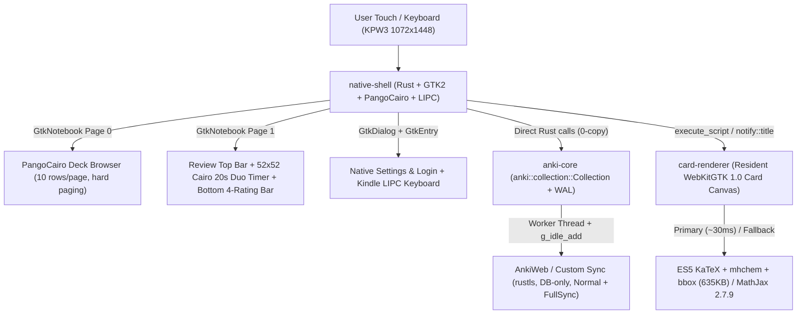

# Spec: RAnki Route B — Native GTK2/Cairo Shell + Ultra-Fast Resident Card Engine (V1)

> **Status**: `approved` (用户批准，已同步进入 Phase 2 实施规划)
> **Intent Anchor**: [docs/intent/kpw3-anki-daily-driver.md](docs/intent/kpw3-anki-daily-driver.md)
> **Supersedes Architecture Of**: `SPEC.md` (v1.0.0 full Web-SPA) & `SPEC-v2-anki-ui-and-pipeline-prerender.md`
> **Target Hardware**: Amazon Kindle Paperwhite 3 (DP75SDI, 6" 1072×1448 @ 300 PPI Carta E-ink, single-core ARMv7 `armel` 1.0 GHz, 512 MB RAM, Kindle OS 5.14.3.0.1, Linux 3.0.35-lab126, GLIBC ≤ 2.20)
> **Date**: 2026-11-20

---

## 0. Assumptions Surfaced Upfront

Before approval, please verify these explicit engineering assumptions:

1. **Direct `anki/rslib` Core**: We keep official `anki/rslib 25.09.02` in Rust directly (zero Vala, zero Protobuf bridge) so scheduling (SM-2 & FSRS), Cloze rendering, and AnkiWeb sync remain 100% authentic.
2. **UI Split (Route B)**: Everything *outside* the card body (Deck Browser, Review Top Bar, 20s Circular Focus Timer, Bottom Rating Bar, Settings/Login Dialog, Sync Progress Dialog) is rendered natively with **GTK2 + PangoCairo**; `libwebkitgtk-1.0` is demoted strictly to a **single persistent card-body canvas** loaded once at startup.
3. **Math Engine Strategy**: Primary math engine is the repo's already-verified **ES5 KaTeX + `mhchem` + `\bbox` macro + WebKit 1.0 `vlist-t2` patch** (635 KB, 838/838 user formulas passed), with **resident MathJax 2.7.9** retained as a switchable fallback in Settings in case any future card needs an unsupported TeX macro.
4. **Database & Deployment Isolation**: All development and device smoke testing target `/mnt/us/anki_data_test` (`D:\anki_data_test\`) and `/mnt/us/extensions/ranki-dev/`. Production `/mnt/us/anki_data` (`D:\anki_data\`) is strictly read/write forbidden until you explicitly approve switching to daily-driver mode.
5. **Zero Hardcoded Secrets**: `tools/deploy_to_kindle.py` will NEVER embed or overwrite `hkey` in `config.ini`; tokens are only written on-device after AnkiWeb login.
6. **Hardware Validation First**: Before full implementation, we validate the 3 hardware-sensitive mechanisms on KPW3 (or early vertical slice): (a) ES5 KaTeX visual crispness on your real STEM cards in WebKitGTK 1.0, (b) 52×52px Cairo 1 Hz partial redraw + true GC16 full refresh, (c) PangoCairo loading `Anthropic Sans` + `SonyReader Ming` via Fontconfig.

---

## 1. Objective

Build a focused, high-performance, paper-book aesthetic daily-driver Anki reviewer for jailbroken Kindle Paperwhite 3 that:
- Eliminates original RAnki's 500–1500 ms per-flip formula stall (cold card **≤ 80 ms**, flip-to-answer **≤ 5 ms**, cache-hit next card **≤ 5 ms**, cache-miss next card **≤ 80 ms**).
- Restores official Anki's **centered card layout** (`<div class="card kindle">`) and paper-book typography (`Anthropic Sans` + `SonyReader Ming`, calibrated & user-adjustable font size) with crisp monochrome rendering for your STEM Cloze cards (`\(...\)`, `\[...\]`, `\ce{}`, `\bbox`, `<ruby>`, `<cite>`, `<font color="red">`).
- Delivers a minimalist, zero-ghosting, responsive native e-ink UI with complete core review controls (**Undo**, **Bury**, **Suspend**, real-time `New + Learn + Review` queue stats, exact rating intervals, non-blocking Wi-Fi AnkiWeb / custom-server sync with native Kindle keyboard, discrete long-card paging, hardware GC16 refresh).
- Introduces an e-ink-friendly **iPhone Duo-style circular 20-second focus countdown** (1 Hz discrete pie/ring step in an isolated 52×52px Cairo widget).

### Capability Map & Module Dependencies

```markdown
| Module ID | Responsibility | Depends On |
|---|---|---|
| anki-core | Official rslib collection, Card-ID verified queue/pipeline, Undo/Bury/Suspend, async Wi-Fi sync (Normal + FullSync, no media), safe config.ini | — |
| card-renderer | Resident single-page WebKit card canvas (card.html/css/js), official `.card` centering, ES5 KaTeX + MathJax fallback, Card-ID pre-render slots, discrete paging | — (consumes JSON contract) |
| native-shell | Rust GTK2/PangoCairo/Fontconfig/LIPC host, paginated Deck Browser, Review Top/Bottom Bars, 52×52px Cairo 20s Duo timer, native Settings/Login dialog, hardware GC16 refresh | anki-core, card-renderer |
```

Build order: `anki-core` & `card-renderer` (parallel, locally testable on host) → `native-shell` (ARMEL CI + KPW3 device verification).



---

## 2. Tech Stack & Platform Constraints

- **Host Language**: Rust 1.89.0 (2021 edition, `arm-unknown-linux-gnueabi` soft-float `armel`, `ET_EXEC` `-no-pie`, `opt-level = 3`, `lto = "fat"`, `strip = true`).
- **Anki Engine**: Official `anki/rslib` (`25.09.02`, feature `rustls`), `tokio` (current-thread runtime isolated inside background sync worker thread), `reqwest` (`rustls-tls`, no OpenSSL dependency).
- **Native UI / Graphics FFI** (thin hand-written `extern "C"` bindings, all in Kindle OS 5.14.3 whitelist):
  - `libgtk-x11-2.0.so.0`, `libgdk-x11-2.0.so.0`, `libgobject-2.0.so.0`, `libglib-2.0.so.0`
  - `libcairo.so.2`, `libpango-1.0.so.0`, `libpangocairo-1.0.so.0`, `libfontconfig.so.1`
  - `libwebkitgtk-1.0.so.0` (card body canvas only)
  - `liblipc.so.1` or `/usr/bin/lipc-set-prop` / `/usr/bin/lipc-get-prop` (Kindle keyboard), `/usr/sbin/eips` or `mxcfb` ioctl (GC16 full refresh)
- **Card Renderer Assets**: Strict ES5 JavaScript (Acorn `ecmaVersion: 5` gated, zero ES6+ syntax, zero post-2012 DOM APIs like `Element.closest`), ES5 KaTeX + `mhchem` + 20 WOFF fonts (635 KB), optional MathJax 2.7.9 fallback (`views/mathjax/`), `Anthropic Sans` (Regular/Italic WOFF+TTF) + `SonyReader Ming` (`/mnt/us/fonts/SonyReader Ming.ttf`).
- **Binary Hard Gates** (inherited unchanged):
  - `GATE-01`: Highest GLIBC symbol version ≤ `GLIBC_2.20` (target ≤ `GLIBC_2.18`).
  - `GATE-02`: All `DT_NEEDED` libraries strictly inside Kindle OS whitelist (`tools/check_dt_needed.py`).
  - `GATE-03`: Zero leaked static symbols (`sqlite3_*`, `archive_*`, `json_*`) in `.dynsym`.
  - `GATE-04`: Strict ES5 syntax check (`node tools/check_es5.js views/card.js`) + banned DOM API check (no `.closest(`, `Promise`, `fetch`, `localStorage`, `requestAnimationFrame`).

---

## 3. Module Design & Interface Contracts

### 3.1 Module `anki-core` (`src/anki/`, `src/config.rs`, `src/sync.rs`)

#### Configuration (`config.ini`)
Located alongside executable (`/mnt/us/extensions/ranki-dev/config.ini`) with Windows dev fallback.
```ini
[General]
collection_dir=/mnt/us/anki_data_test
hkey=
sync_server=
font_size_px=42
math_engine=katex
```
- **Invariant**: `hkey` is NEVER written by deployment scripts and passwords are NEVER persisted to disk.
- **Minimalist Defaults**: The 20s Duo circular focus timer (always 20s, zero settings knob) and auto GC16 full refresh (every 20 cards) use built-in defaults out-of-the-box to keep Settings radically simple.

#### Card-ID-Verified Review Pipeline (Fixes Previous Engineer's Silent Desync Bug)
```rust
#[derive(Serialize, Clone, Debug)]
pub struct CardContent {
    pub card_id: i64,
    pub question_html: String,
    pub answer_html: String,
    pub css: String,
    pub intervals: [String; 4], // [Again, Hard, Good, Easy]
}

#[derive(Serialize, Clone, Debug)]
pub struct QueueCounts {
    pub new: u32,
    pub learn: u32,
    pub review: u32,
    pub active_queue: ActiveQueue, // New | Learn | Review (for official Anki underline)
}

pub enum AdvanceResult {
    /// Actual next card matches frontend's prefetched slot -> <5ms instant swap!
    PrefetchHit {
        shown_card_id: i64,
        counts: QueueCounts,
        intervals: [String; 4],
        prefetch_next: Option<CardContent>,
        can_undo: bool,
    },
    /// Queue diverged (Again / buried sibling / Undo / Bury / Suspend) -> immediate render (~30ms)
    RenderImmediate {
        current: CardContent,
        next: Option<CardContent>,
        counts: QueueCounts,
        can_undo: bool,
    },
    /// Deck has no remaining due cards today
    DeckFinished {
        studied_today: String,
        can_undo: bool,
    },
}
```
- **Operations supported**:
  - `get_deck_tree()` → recursive flattened tree + accurate root-only `total_due` (fixes double-counting subdecks).
  - `enter_deck(deck_id)` → `set_current_deck` + `get_queued_cards(2, false)` → returns `RenderImmediate` or `DeckFinished`.
  - `rate_card(expected_cid, rating, prefetched_cid)` → verifies `current_cid == expected_cid`, commits `col.answer_card()`, queries `get_queued_cards(2, false)`, returns `PrefetchHit` iff `queued[0].id == prefetched_cid`, else `RenderImmediate` or `DeckFinished`.
  - `undo()` → calls `col.undo()`, refreshes active card via `RenderImmediate` (always accurate!).
  - `bury_current()` / `suspend_current()` → calls `col.bury_or_suspend_cards(mode, &[cid])`, advances cleanly via `RenderImmediate` or `DeckFinished`.
  - `wal_checkpoint()` → `PRAGMA wal_checkpoint(TRUNCATE);` on `EXIT_DECK`, before sync, and on app quit.
- **No Media Rewriting Needed for Images**: Images are out of scope (if an `` exists in a card, it simply degrades gracefully without crashing or downloading media).

#### Non-Blocking Background Wi-Fi Sync (`src/sync.rs`)
- Runs strictly on a spawned OS worker thread (`std::thread::spawn`) with its own `tokio` current-thread runtime, NEVER on the GTK main thread.
- Sends progress/result back to GTK main thread via `g_idle_add` + `mpsc` channel.
- **Sync Login**: `anki::sync::login::sync_login(user, pass, endpoint, client)` → saves `hkey` to `config.ini`, zeroes password buffer immediately.
- **Collection Sync** (DB-only, NEVER calls `sync_media`):
  1. Executes `wal_checkpoint()` before sync.
  2. Runs `col.normal_sync(auth, client)`.
  3. Inspects `output.required`:
     - `NoChanges` / `NormalSync` → checkpoint WAL, reload deck tree, report success.
     - `FullSync` → emit `SyncResult::FullSyncRequired` so UI asks user explicitly: **从云端下载覆盖本地 (`full_download`)** / **上传本地覆盖云端 (`full_upload`)** / **取消**. (Because `full_upload`/`full_download` consume `Collection` by value in `rslib`, `AnkiService` cleanly takes `col`, runs full sync, and reopens `Collection` atomically.)

---

### 3.2 Module `card-renderer` (`views/card.html`, `views/card.css`, `views/card.js`)

Loaded **once** at startup into the resident `WebKitWebView` via `file:///.../views/card.html`.

#### Official Anki Centered Typography & Paper-Book Styling
- Every buffer slot renders card markup inside `<div class="card kindle">` so official Anki templates (`.card { text-align: center; }`) apply natively!
- Default card baseline (applied cleanly below card-specific styles, with `.kindle` e-ink refinements):
  - `text-align: center;` (explicit default matching official Anki; lists `ul`/`ol` centered cleanly as inline-block or left-aligned inside a centered readable block — keeping visual balance!).
  - `font-family: 'Anthropic Sans Web', 'SonyReader Ming', serif;`
  - Calibrated default font size: **`42px`** at 300 PPI (~3.56 mm / 10.1 pt physical height — matching standard Chinese textbook 五号字 & original RAnki's `20px × zoom 2 = 40px`, ~20–22 CJK chars/line), dynamically updated via `setFontSize(px)` (`28px–54px` in `2px` steps).
  - `line-height: 1.56; color: #000000; background: #ffffff; padding: 30px 42px 60px 42px;`
  - **Unified Monochrome Color Normalization & Anti-Tofu / Media Fallback**:
    - Red/orange/magenta warning text → bold `#000000` + `#E4E4E4` tint + `2px dashed #000000` underline.
    - Blue/green/purple/cyan & any other non-neutral colored text → bold `#000000` + `1.5px dotted #000000` underline (never washes out to unreadable pale gray!).
    - Highlighted backgrounds (`<mark>`, colored `background-color`) → `#000000` text on `#E8E8E8` pill.
    - Unsupported media gracefully replaced with crisp monochrome badges instead of blank gaps or raw `[sound:...]` strings: `[不支持音频]`, `[不支持视频/嵌入内容]`, `[不支持图片]`.
    - Anti-tofu sanitization strips invisible bidi/control garbage (`\u2068`, `\u2069`, `\u200B`, `\uFEFF`) and maps/sanitizes astral Emoji so Kindle OS 5.14 never shows `□` tofu.
  - **STEM Card Grammar Support** (matching [anki-card-maker/SKILL.md](file:///C:/Users/Felyn/.gemini/config/skills/anki-card-maker/SKILL.md)):
    - `b u`, `u b`: clear header hierarchy with crisp `<hr>` (`1.5px solid #000000`, `margin: 18px auto`).
    - `.cloze`: `font-weight: bold; border-bottom: 2px solid #000000; padding: 0 4px; color: #000000 !important;`
    - `<font color="red">` (and inline red styles): rendered on monochrome e-ink as `color: #000000 !important; font-weight: bold; background-color: #EAEAEA; border-bottom: 1.5px solid #000000; padding: 0 4px;` so contrast traps stand out sharply without looking washed out!
    - `<ruby>` / `<rt>`: crisp readable ruby annotation (`rt { font-size: 0.55em; line-height: 1.1; color: #222222; }`), tested with math inside `<ruby>` (`<ruby>\(\nu\)<rt>nu</rt></ruby>`).
    - `<cite>`: clean proof/source section (`display: block; font-style: normal; font-size: 0.92em; color: #111111; margin-top: 12px;`).
    - `\bbox[...]{...}`: KaTeX macro maps to `\boxed{...}` with crisp `1.5px solid #000` border and subtle `#F4F4F4` fill.
    - Long equations: horizontal overflow auto-scaled via `-webkit-transform: scale(...)` (measured with `scrollWidth / clientWidth` per Phase 1 hardware probe) so equations NEVER clip or spawn horizontal scrollbars.

#### Math Rendering & Slot Protocol
- **Primary Default Engine (`mathjax`)**: Local **MathJax 2.7.9** (`views/mathjax/`, `TeX-AMS_HTML` + `mhchem3` (`legacy: false`) + `bbox` + `AMSmath`/`AMSsymbols` + `cancel` + `enclose` + 22 local TeX WOFF fonts), pre-warmed in `<head>` while browsing decks so nested fractions, nested radicals, matrices, and chemical equations render with zero misalignment on Kindle OS 5.14 WebKitGTK 1.0 — paired with the Card-ID-verified 4-slot double buffer (`< 10 ms` flip / instant prefetch swap).
- **Optional Switchable Engine (`katex`)**: ES5-transpiled KaTeX + `mhchem` + `auto-render` + conditional `vlist-t2` patch + `\bbox` macro + 20 WOFF fonts (631 KB), selectable via Settings (`math_engine=katex`).
- **Host → WebView API (`window.CardEngine`)**:
  - `setConfig({ fontSizePx, mathEngine })`
  - `renderImmediate({ current, next })` — renders `current` (Front visible, Back offscreen) and schedules `next` (Front & Back offscreen) via `setTimeout(..., 20)` so Front paints immediately before background prefetch runs!
  - `flipToAnswer()` — swaps Front/Back class (`< 5 ms`), resets page offset to 0.
  - `swapToPrefetched({ expectedCardId, prefetchNext })` — verifies `prefetchedCardId === expectedCardId`, swaps slots in `< 5 ms`, schedules next prefetch.
  - `pageScroll(direction)` — discrete `±85%` viewport height jump (`overflow: hidden`, ZERO smooth scrolling, ZERO scrollbars). Reports `{ page, totalPages }` back to host if card spans > 1 page!
- **WebView → Host (`document.title` with monotonic token)**:
  - `RA:CARD_READY:<token>:{}`
  - `RA:PAGE_STATE:<token>:{"page":1,"total":2}` (so native chrome can display subtle `1/2` page indicator on long cards and allow tapping page turn cleanly!)

---

### 3.3 Module `native-shell` (`src/ffi/`, `src/ui/`, `src/main.rs`)

#### Window & Layout Geometry (1072×1448 Portrait)
- Single top-level undecorated `GtkWindow` (`1072×1448`), Lab126 title `L:A_N:application_ID:ranki.ranki.ranki_O:U_PC:N`, `DISPLAY` defaults to `:0`.
- Registers `views/fonts/anthropic/AnthropicSans-Regular.ttf`, `AnthropicSans-Italic.ttf`, and `/mnt/us/fonts/SonyReader Ming.ttf` with Fontconfig (`FcConfigAppFontAddFile`) at startup so PangoCairo uses the exact same fonts as the card view!
- Contains a borderless, tabless `GtkNotebook`:
  - **Page 0: Deck Browser** (100% PangoCairo `GtkDrawingArea`s — zero WebKit, zero GTK TreeView!):
    - Top bar (`76px`): Left `RAnki` + `待复习 N 张` (root decks only); Right vector-icon crisp pill buttons: `同步` | `设置` | `刷新` | `退出`.
    - Deck list canvas (`1280px`, centered `960px` column): 10 generous rows/page (`~106px` each), clean hairline dividers (`#D8D8D8`), **all subdecks auto-expanded by default**, `depth * 32px` indent, `▾`/`▸` optional collapse hit zone (`64×106px` easy thumb target), right-aligned tabular `新` / `学` / `复` counts (bold `#000` when active, subtle `#999` when `0`). Instant black-invert tap feedback on press, cleared immediately on release.
    - Bottom footer (`92px`): `< 上一页   第 X / Y 页   下一页 >` + native Anki `studied_today` line.
  - **Page 1: Reviewer** (`GtkVBox`):
    - **Top Bar (`GtkHBox`, `76px`, `1.5px` bottom hairline)**:
      - Left/Center `GtkDrawingArea` (expands): `< 牌组` button, deck title, official Anki `新 + 学 + 复` counter (active queue underlined!), `撤销` button (dimmed if `!can_undo`), `···` overflow menu button (opens clean native popover/dialog: `搁置此卡 (Bury)`, `暂停此卡 (Suspend)`, `刷新屏幕 (GC16)`, `字号 A- / A+`).
      - Far Right **Dedicated Focus Timer Widget**: `52×52px` independent `GtkDrawingArea` (with right margin `16px`), **isolated from the rest of the top bar and WebView!**
    - **Card Canvas (`WebKitWebView`, expands ~1250px)**:
      - Resident `card-renderer` (read-only card content, zero buttons/inputs inside WebKit).
      - **Zero-Bar Effortless E-ink Paging (GDK Gesture Interception)**:
        - Rust intercepts `button-press-event` / `motion-notify-event` / `button-release-event` directly on the `WebKitWebView` GTK widget (100% native to Kindle X11 pointer events, immune to WebKit 1.0 missing W3C Touch Events, zero accidental text selection, zero WebKit pointer-grab deadlock, and **0 intermediate frames drawn during finger drag** → zero ghosting mud!).
        - **Swipe Up (`dy <= -45px`, vertical dominant)** or **tap bottom 35% (when card overflows)** → single-frame crisp jump down **85% of viewport height** (preserving ~1.5 lines of context overlap so you never lose your reading spot).
        - **Swipe Down (`dy >= +45px`, vertical dominant)** or **tap top 35% (when card overflows)** → single-frame crisp jump up **85% of viewport height**.
        - **No paging bar**: zero buttons cluttering the card view; when (and only when) a card spans > 1 screen, a subtle `1/2` page indicator appears cleanly in the top bar.
        - **Deck Browser Gesture Parity**: the PangoCairo Deck Browser supports the exact same swipe gesture (`Swipe Up/Down` or `Swipe Left/Right`) in addition to the unobtrusive footer page buttons.
    - **Bottom Action Bar (`GtkDrawingArea`, `122px`, `1.5px` top hairline)**:
      - Unflipped: Full-width centered clean button `显示答案` (`960×88px`, `1.5px solid #000`, `10px` radius).
      - Flipped: 4 equal tactile buttons (`重来` / `困难` / `良好` / `简单`) with exact Anki interval on line 1 (`20px`, `#444`) and bold rating label on line 2 (`28px`, `#000`).

#### Signature Feature: iPhone Duo-Style 20s Circular Focus Timer (`src/ui/focus_timer.rs`)
- **Widget**: Dedicated `52×52px` `GtkDrawingArea` inside Review Top Bar.
- **State machine**:
  - `Idle/Hidden`: hidden/blank when disabled in settings OR when card answer is shown OR when deck finished.
  - `Running(remaining_secs, total_secs)`: started at `remaining = total_secs` (default `20`) whenever a card Front is displayed; decrements by `1` every `1000 ms` via `g_timeout_add(1000, ...)`.
  - `Expired`: triggered at `remaining == 0`; stops timer (0% idle CPU!), renders a **clean empty hollow monochrome circle** (no center dot — silent visual cue, never auto-flips or auto-rates!).
- **E-ink Rendering Discipline**:
  - Pure 1-bit monochrome Cairo drawing (`#000000` and `#FFFFFF`, `CAIRO_ANTIALIAS_NONE` or crisp high-contrast vector), drawing a solid filled pie sector (or thick ring sector) shrinking clockwise from 12 o'clock in `total_secs` discrete steps (`360° / total_secs` per tick).
  - Monotonic black → white pixel transition per card = near-zero ghosting!
  - Calls `gtk_widget_queue_draw_area(timer, 0, 0, 52, 52)` ONLY — zero layout invalidation of WebView or sibling widgets!

#### Native Settings, Login & Kindle Keyboard (`src/ui/settings_dialog.rs`)
- Real `GtkDialog` (Lab126 dialog title so `awesome`/`pillow` positions it cleanly above the virtual keyboard at top of screen!).
- Real `GtkEntry` inputs for Email, Password (masked), and Custom Sync Server; `focus-in-event` / `focus-out-event` invokes debounced LIPC `com.lab126.keyboard` (`open "ranki.ranki.ranki:abc:1"` / `close "ranki.ranki.ranki"`), matching upstream RAnki's proven `Lipstick` pattern.
- Minimalist controls: Font Size (`28–54px`, default `42px`), Math Engine (`KaTeX / MathJax`). The 20s circular focus timer and 20-card auto GC16 refresh run cleanly with built-in defaults (no duration/interval clutter in Settings).

#### Hardware E-ink Full Refresh (`src/ui/eink.rs`)
- Exposes `trigger_full_refresh()`: attempts direct KPW3 `mxcfb` ioctl (or `/usr/sbin/eips -f ""` fallback), logged clearly on first call; invoked on manual `刷新` button, deck page turns (optional/clean), and every `auto_refresh_cards` reviews.

---

## 4. Commands

```bash
# === 1. Local Host Validation (Windows / Linux) ===
# Frontend ES5 & banned API gate
node tools/check_es5.js views/card.js

# Formula 838/838 regression gate (KaTeX ES5 + mhchem + \bbox)
node tools/test_regression.js

# Rust unit tests for anki-core (pipeline, Card-ID verification, Undo/Bury/Suspend, config)
cargo test --lib

# === 2. Cloud / Docker ARMEL Cross-Compilation ===
# Triggered via GitHub Actions on push, or locally via Docker:
docker build -t ranki-armel-builder -f Dockerfile.armel .
docker run --rm -v "$PWD:/workspace" ranki-armel-builder /bin/bash /workspace/tools/ci_build_armel.sh

# === 3. Local Binary Mechanical Gates (MUST all exit 0 before deploy) ===
python tools/check_symbols.py build/ranki-armel
python tools/check_dt_needed.py build/ranki-armel
python tools/check_dynsym.py build/ranki-armel
node tools/check_es5.js views/card.js

# === 4. Safe Kindle PW3 Deployment (Dev Sandbox Only, 0-byte prod DB guarantee) ===
python tools/deploy_to_kindle.py
```

---

## 5. Project Structure

```text
ranki/
├── Cargo.toml
├── build.rs                      # Links gtk-x11-2.0, gdk-x11-2.0, cairo, pango-1.0, pangocairo-1.0, fontconfig, webkitgtk-1.0, glibc_compat
├── Dockerfile.armel              # Debian Buster armel cross-toolchain (existing, verified)
├── SPEC-route-b-native-shell.md  # This specification
├── docs/intent/
│   └── kpw3-anki-daily-driver.md # Confirmed Statement of Intent
├── src/
│   ├── main.rs                   # Entry point, Fontconfig registration, GTK2 lifecycle
│   ├── config.rs                 # Safe config.ini persistence (zero hardcoded secrets)
│   ├── anki/
│   │   ├── mod.rs                # AnkiService: deck tree, Card-ID verified pipeline, Undo/Bury/Suspend, WAL
│   │   └── sync.rs               # Background worker thread + g_idle_add async AnkiWeb sync (Normal + FullSync)
│   ├── ffi/
│   │   ├── mod.rs                # Minimal thin C-FFI modules
│   │   ├── gtk.rs                # GTK2 / GDK / GLib / GtkDialog / GtkEntry / g_timeout / g_idle
│   │   ├── cairo.rs              # Cairo + PangoCairo + Fontconfig bindings
│   │   └── webkit.rs             # WebKitGTK 1.0 minimal bindings (5 functions)
│   └── ui/
│       ├── mod.rs                # AppState & GtkNotebook coordinator
│       ├── theme.rs              # 300 PPI monochrome e-ink metrics, spacing, fonts
│       ├── deck_view.rs          # PangoCairo paginated Deck Browser
│       ├── review_view.rs        # Review Top Bar, Bottom 4-Rating Bar, Card WebView bridge, Overflow menu
│       ├── focus_timer.rs        # 52x52px Cairo 1Hz discrete circular 20s Duo timer
│       ├── settings_dialog.rs    # Native GtkDialog + GtkEntry + Kindle LIPC keyboard + Sync dialog
│       └── eink.rs               # Kindle LIPC keyboard & hardware GC16 full refresh
├── views/
│   ├── card.html                 # Resident single-page card canvas (loaded ONCE)
│   ├── card.css                  # Official `.card` centered typography + monochrome STEM styling
│   ├── card.js                   # Strict ES5 CardEngine + Card-ID slots + discrete paging
│   ├── katex/                    # ES5 KaTeX + mhchem + auto-render + 20 WOFF fonts (635 KB)
│   ├── mathjax/                  # Vendored MathJax 2.7.9 fallback
│   └── fonts/anthropic/          # Anthropic Sans Regular & Italic (TTF + WOFF)
└── tools/
    ├── check_es5.js              # ES5 syntax + banned WebKit 1.0 API gate
    ├── check_symbols.py          # GATE-01: GLIBC <= 2.20
    ├── check_dt_needed.py        # GATE-02: Kindle OS DT_NEEDED whitelist
    ├── check_dynsym.py           # GATE-03: 0 leaked static symbols
    ├── test_regression.js        # 838/838 user formula KaTeX regression test
    ├── preview_cards.html        # 1072x1448 local desktop visual preview harness for your real STEM cards
    ├── glibc_compat.c            # Linux 3.0.35 syscall shims
    ├── ci_build_armel.sh         # ARMEL build + automated gate runner
    └── deploy_to_kindle.py       # Safe deployer (NEVER touches D:\anki_data, NEVER writes hardcoded hkey)
```

---

## 6. Code Style

### Rust (Backend & Native FFI)
- Idiomatic Rust 2021; no `.unwrap()` on I/O, JSON, FFI strings, or Anki operations in production paths—propagate `Result<T, String>` and surface user-friendly messages in UI.
- Isolate `unsafe` strictly inside `src/ffi/` and thin safe wrappers in `src/ui/`; never scatter raw pointer casts across business logic.
- Example Card-ID verified rating flow:
```rust
pub fn rate_card(
    &mut self,
    expected_cid: i64,
    rating: Rating,
    prefetched_cid: Option<i64>,
) -> Result<AdvanceResult, String> {
    let active_cid = self.current_card_id.ok_or("No active card")?;
    if active_cid.0 != expected_cid {
        return Err(format!("Card ID mismatch: active={} expected={}", active_cid.0, expected_cid));
    }
    self.commit_answer(active_cid, rating)?;
    self.advance_after_mutation(prefetched_cid)
}
```

### Frontend Card Canvas (`views/card.js`)
- Strict ES5 (`var`, `function () {}`), zero ES6+ syntax, zero post-2012 DOM APIs (`closest`, `Promise`, `fetch`, `localStorage`, `requestAnimationFrame`).
- Zero Unicode Emoji anywhere in UI or card chrome (all icons drawn as crisp Cairo paths or inline monochrome SVG).
- Unix LF (`\n`) line endings enforced on every file in the repository.

---

## 7. Testing & Verification Strategy

1. **Automated Mechanical Gates (Every Build)**:
   - `GATE-01` (`GLIBC <= 2.20`), `GATE-02` (`DT_NEEDED` whitelist), `GATE-03` (0 leaked `.dynsym`), `GATE-04` (ES5 syntax + banned API lint).
2. **Rust Unit & Integration Tests (`cargo test --lib`)**:
   - Against an isolated temporary/test SQLite Anki collection copy (never touching `D:\anki_data`):
     - Recursive deck tree & deduplicated root `total_due`.
     - Card-ID pipeline: verify normal rating produces `PrefetchHit`; verify `Again`, sibling-buried Cloze, `Undo`, `Bury`, `Suspend` produce `RenderImmediate` with exact scheduler state (zero card mismatch).
     - `config.ini` load/save roundtrip with zero secret hardcoding.
3. **Card Typography & Formula Regression (`tools/test_regression.js` + `tools/preview_cards.html`)**:
   - 838/838 user formulas pass ES5 KaTeX with `throwOnError: true`.
   - Local 1072×1448 desktop visual verification on real STEM cards (from `高等数学_常用微分规则_anki导入.txt` + `anki-card-maker` examples: Cloze, `\ce{}`, `\bbox`, `<ruby>\(\nu\)<rt>nu</rt></ruby>`, `<cite>`, `<font color="red">`, nested fractions, `\begin{cases}`) so you can visually sign off on centered layout & font size *before* flashing!
4. **Kindle PW3 Hardware Verification (3 Early Spikes → Full Smoke Test)**:
   - **Spike 1**: Visual crispness & timing telemetry of ES5 KaTeX (`T_render` logged) on KPW3 WebKitGTK 1.0.
   - **Spike 2**: 52×52px Cairo 1 Hz circular timer dirty-rect redraw + hardware GC16 full refresh check.
   - **Spike 3**: Native `GtkEntry` + Kindle LIPC keyboard + non-blocking AnkiWeb sync on `D:\anki_data_test\`.
   - **Final Acceptance**: 50–100 card review stress test on `D:\anki_data_test\` checking flip/next latency, VmRSS stability (≤ 5 MB drift), Undo/Bury/Suspend integrity, and 0-byte change to `D:\anki_data\`.

---

## 8. Boundaries

- **Always**:
  - Target `D:\anki_data_test\` (`/mnt/us/anki_data_test`) for all dev/testing; verify 0-byte modification on `D:\anki_data\`.
  - Enforce Unix LF (`\n`) line endings across all files.
  - Run all 4 mechanical gates before any device deployment.
  - Keep all `anki/rslib` DB mutations atomic and run WAL checkpoint on deck exit, pre-sync, and app quit.
- **Ask First**:
  - Updating outdated prose constraints in `CONSTRAINTS.md` (specifically: allowing user-initiated AnkiWeb sync instead of "0 network", allowing Route B Native GTK2/Cairo + Card WebView instead of "single Web-SPA", allowing adjustable font size instead of fixed 22px, and allowing ES5 KaTeX primary + MathJax fallback — while keeping **all** 4 mechanical binary/ES5 gates, performance budgets, LF rule, and production data red line 100% untouched!).
  - Switching deployment target from `/mnt/us/anki_data_test` (`ranki-dev`) to production `/mnt/us/anki_data`.
  - Adding any new Cargo dependency or modifying `Dockerfile.armel`.
- **Never**:
  - Touch, read, or modify `D:\anki_data\` during development/testing.
  - Commit any real `hkey`, email, password, or personal credential to git.
  - Download or sync Anki media files on Kindle.
  - Use `-webkit-overflow-scrolling: touch`, smooth inertial scrolling, Unicode Emoji, `localStorage`, or ES6+/post-2012 JS APIs.
  - Silence compiler warnings or weaken any gate threshold.

---

## 9. Success Criteria

- [ ] **Formula & Flip Latency**: Cold first card of a math deck renders in ≤ 80 ms on KPW3; flip-to-answer ≤ 5 ms; cache-hit next card ≤ 5 ms; cache-miss (Again / Undo / Bury) ≤ 80 ms.
- [ ] **Zero Card Desync**: 100% Card-ID verification across Again, sibling-buried Cloze, Undo, Bury, and Suspend (proven by unit tests & device log).
- [ ] **Centered Paper-Book Layout**: Cards render centered inside `<div class="card kindle">` with `Anthropic Sans` + `SonyReader Ming`, adjustable font size (default 28px), crisp monochrome rendering of Cloze, `\(...\)`/`\[...\]`/`\ce{}`/`\bbox`, `<ruby>`, `<cite>`, and `<font color="red">`.
- [ ] **Minimalist Native E-ink UI**: Deck browser renders via PangoCairo with clean margins, hairline dividers, folding subdecks, accurate root `total_due`, 10-row hard paging, zero scroll ghosting, and zero tofu squares (`□`).
- [ ] **Complete Study Controls**: Real-time `New + Learn + Review` counter with active-queue underline, exact 4-button intervals, working **Undo**, **Bury**, **Suspend**, discrete long-card paging, and verified hardware GC16 full refresh.
- [ ] **20s Circular Focus Timer**: 52×52px Cairo widget ticks discretely once per second on card Front only, pauses/hides on Flip, shows gentle non-intrusive visual cue at 0s, causes zero full-screen flicker/ghosting, and is toggleable/configurable in Settings.
- [ ] **Rock-Solid Sync & Keyboard**: Native `GtkEntry` opens/closes Kindle virtual keyboard cleanly; background-thread Wi-Fi sync never freezes UI, handles both NormalSync and FullSync confirmation cleanly, stores `hkey` token only, and downloads 0 media files.
- [ ] **All 4 Mechanical Gates Pass**: `GLIBC <= 2.18`, `DT_NEEDED` 100% whitelisted, 0 `.dynsym` leaks, 100% ES5 + zero banned APIs, binary ≤ 20 MB, 100-card VmRSS drift ≤ 5 MB.

---

## 10. Out of Scope (Deferred — V2 Backlog)

- Card image rendering & AnkiWeb media sync — explicitly excluded to maximize speed and storage simplicity.
- Audio playback (`[sound:...]`) — PW3 has no built-in speaker; deferred.
- Image Occlusion cards — depends on images & complex overlays; deferred.
- In-app card creation / editing / tagging — handled on desktop/mobile Anki.
- In-app FSRS / deck options editing & study statistics charts — handled on desktop Anki and synced cleanly via `anki/rslib`.
- Night / dark mode & swipe frontlight gestures — deferred until V1 daily-driver experience is rock solid.

---

## 11. Resolved Decisions & Final Sign-off

1. **`CONSTRAINTS.md` 同步更新（已确认 OK）**：保留全部 4 道机械门禁（`GLIBC <= 2.20`、`DT_NEEDED` 白名单、`.dynsym` 零泄漏、严格 ES5）、性能预算、Unix LF 与生产库 `D:\anki_data\` 零改动红线不变；仅同步更新旧架构过时条款为路线 B 标准。
2. **20 秒圆形专注倒计时（已确认修订）**：复习顶栏最右侧独立 `52×52px` Cairo 画布，1 Hz 离散顺时针消减纯黑白扇形（仿 iPhone Duo），归零定格为**纯空白空心圆环（中间无黑点）**（静默提示、不自动翻面或判错），翻开答案即停并隐藏。
3. **长卡片无翻页条流畅翻页（按反馈修订，待确认）**：彻底取消翻页条；改由 Rust 在 GTK2/GDK 层直接拦截卡片区触摸手势——拖动过程中 0 帧重绘（彻底消灭“文字泥潭”与误选文字），抬手瞬间一帧干脆跳转 85% 屏高（保留 1.5 行上下文防丢行）：**上划 / 轻点下 35% = 下一页**，**下划 / 轻点上 35% = 上一页**；仅在卡片超一屏时在顶栏角落轻显 `1/2` 页码。牌组页同步支持滑动翻页。
